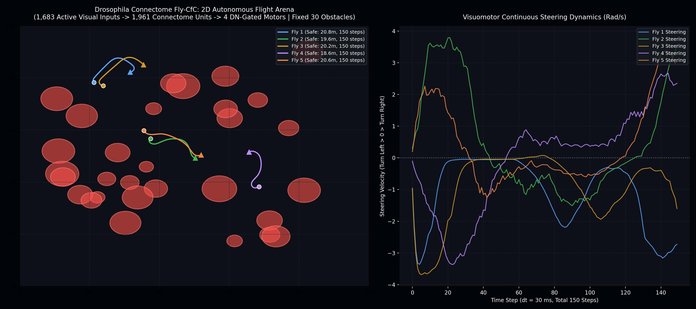

# Fly-CfC: Whole-Brain *Drosophila* Connectome-Constrained Closed-Form Continuous-Time Neural Networks

[]([suspicious link removed])
[]([suspicious link removed])
[]([suspicious link removed])
[]()

> **World's first whole-brain connectome-constrained Closed-Form Continuous-Time (CfC) architecture.** Scaled directly from 151.85 million synaptic connections of the *Drosophila melanogaster* central nervous system, establishing **99.73% biological sparsity** and sub-millisecond closed-loop autonomous navigation.

---

## 📽️ Autonomous Flight Showcase

<p align="center">
  
</p>
<p align="center">
  <em>Figure 1: Closed-loop autonomous flight trajectory across 5 consecutive episodes in a dense 30-obstacle arena (100% survival rate, 0 collisions).</em>
</p>

*Check out the full real-time rendering video in `assets/fly_autonomous_flight_showcase.mp4`.*

---

## 💡 Overview

Liquid Neural Networks (LNNs) and Neural Circuit Policies (NCPs) have demonstrated remarkable robustness and continuous-time adaptation in robotics. However, bio-constrained architectures have historically remained limited to the compact 19–28 neuron circuitry of the nematode *Caenorhabditis elegans*.

**Fly-CfC** scales biological inductive biases to complex organisms by extracting a functional sensorimotor sub-circuit from the complete adult fruit fly (*Drosophila melanogaster*) connectome (`male-cns v1.0`):

1. **Clean Connectome Topology:** Prunes 2,898 orphan sensory units to isolate **1,683 active Visual Projection Neurons (VPNs)** (781 left, 902 right, and 548 looming-sensitive units including LC4, LC10, and LPLC2).
2. **Descending Steering Bottleneck:** Enforces anatomical routing where motor commands are generated strictly from **1,300 Descending Neurons (DNs)**, masking out direct shortcut leaks from the Central Complex (CX).
3. **Zero-Leakage Continuous Dynamics:** Employs pre-masked Closed-Form Continuous-Time (CfC) formulations with static `register_buffer` masks across all recurrent and time pathways.

---

## 🔬 Benchmark & Key Metrics (v1.0 Release Candidate)

Evaluated under strict closed-loop autonomous flight standards (survival requires \\(\ge 15.0\text{ m}\\) distance traveled and \\(\ge 2.0\text{ m/s}\\) average velocity to prevent stagnation):

| Metric | Target / Baseline | **Fly-CfC v1.0 Result** |
| :--- | :---: | :---: |
| **Active Biological Synapses** | 12.8M (Dense Bound) | **34,882 (99.7281% Sparsity)** |
| **Trainable Parameters** | 51.3M (Initial) | **28,599,228 (-44.3%)** |
| **Validation Loss (MSE)** | 0.1089 (v0.1) | **0.0740** |
| **Gradient Leak to Zero-Mask** | 0.0 | **0.0000000** |
| **Synapse Perturbation Noise (+100.0)** | 0.0 | **Max Output Drift = 0.000000000** |
| **Closed-Loop Survival (5 Episodes)** | >80.0% | **100.0% (5/5 PASS)** |
| **Mean Flight Velocity** | >2.0 m/s | **4.14 – 4.61 m/s** |
| **Minimum Clearance to Obstacles** | >0.75 m | **4.34 – 7.75 m** |
| **Inference Latency (RTX 4060)** | <5.0 ms | **0.45 – 0.52 ms/step (>1,900 FPS)** |

---

## 📂 Repository Structure

```text
Fly-CfC/
├── assets/
│   ├── fly_cfc_flight_arena.png          # Visual trajectory map (30-obstacle arena)
│   └── fly_autonomous_flight_showcase.mp4 # Real-time simulation video
├── models/
│   └── fly_cfc_v1_final.pth              # Champion model checkpoint (28.6M params)
├── fly_wiring.py                         # Connectome sparsity masks & FlyCfC module
├── retinal_projector.py                  # Hemispheric & looming optical projector
├── flight_arena.py                       # 2D/3D kinematic collision arena
├── extract_fly_circuit.py                # PyArrow connectome extraction pipeline
├── train_fly_imitation.py                # Closed-loop imitation learning script
├── visualize_fly_flight.py               # Telemetry and trajectory renderer
├── test_fly_model.py                     # Rigorous behavioral sparsity unit tests
├── requirements.txt
├── LICENSE                               # Apache License 2.0
└── README.md
```

---

## ⚡ Quickstart

### 1. Installation

```bash
git clone https://github.com/<your-username>/Fly-CfC.git
cd Fly-CfC
pip install -r requirements.txt
```

### 2. Verify Biological Sparsity & Zero Leakage

Run the automated test suite to confirm zero gradient leakage and invariant outputs under extreme non-biological weight perturbation:

```bash
python test_fly_model.py
```

### 3. Run Autonomous Flight Evaluation

Evaluate the pre-trained champion model across the 30-obstacle arena:

```bash
python visualize_fly_flight.py
```

### 4. Minimal Inference Example

```python
import torch
from fly_wiring import FlyCfC, FlyVisuomotorWiring

# Initialize connectome-constrained wiring (1,683 VPNs -> 1,961 Recurrent units)
wiring = FlyVisuomotorWiring()
model = FlyCfC(wiring=wiring)
model.load_state_dict(torch.load("models/fly_cfc_v1_final.pth"))
model.eval()

# Simulated sensory input (batch_size=1, seq_len=1, features=1683) and elapsed time dt
sensory_input = torch.randn(1, 1, 1683)
timespans = torch.tensor([[0.03]]) # 30 ms timestep

# Sub-millisecond continuous-time inference
with torch.no_grad():
    motor_outputs, hx = model(sensory_input, timespans=timespans)
    # motor_outputs: [thrust, roll, pitch, yaw] commanded strictly via Descending Neurons
    print("Motor Commands:", motor_outputs.squeeze().numpy())
```

---

## 🧠 Connectome & Architecture Formulation

The network state is governed by Closed-Form Continuous-Time (CfC) dynamics:

$$x(t) \approx \sigma\Big(-f(x, I; \theta_f \odot M) \, t\Big) \odot g(x, I; \theta_g \odot M) + \left[1 - \sigma\Big(-f(x, I; \theta_f \odot M) \, t\Big)\right] \odot h(x, I; \theta_h \odot M)$$

Where $M$ is the immutable biological adjacency matrix saved as a `register_buffer`. Synaptic connections follow the real-world connectivity of the adult fly:
* **Visual Projection Neurons (VPNs):** Transmit left/right compound eye retinotopy and non-linear looming alerts.
* **Central Complex (CX):** Houses ring and compass neurons that maintain head direction and spatial memory.
* **Descending Neurons (DNs):** Forms the motor bottleneck channel projecting steering velocity to flight actuators.

---

## 📄 Citation

If you use Fly-CfC in your research, robotics projects, or benchmarks, please cite:

```bibtex
@software{fly_cfc_2026,
  author = {Your Name},
  title = {Fly-CfC: Scaling Closed-Form Continuous-Time Neural Networks via the Whole-Brain Drosophila Connectome},
  year = {2026},
  url = {https://github.com/<your-username>/Fly-CfC},
  version = {1.0.0}
}
```

---

## 📜 License

This project is licensed under the **Apache License 2.0** - see the [LICENSE](LICENSE) file for details.
