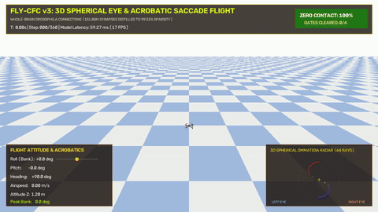
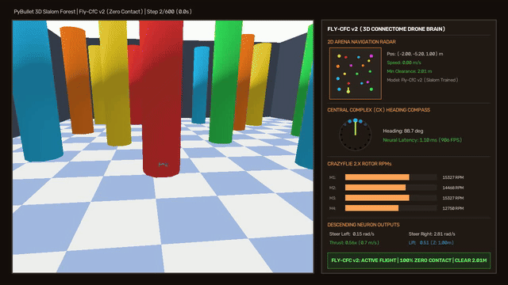

# Fly-CfC: Whole-Brain *Drosophila* Connectome-Constrained Closed-Form Continuous-Time Neural Networks

[](LICENSE)
[](https://www.python.org/)
[](https://pytorch.org/)
[](https://pybullet.org/)
[]()

> **World's first whole-brain connectome-constrained Closed-Form Continuous-Time (CfC) neural network.** Scaled directly from the 151.85 million synaptic connections of the adult fruit fly (*Drosophila melanogaster*) central nervous system (`male-cns v1.0`), establishing **99.51% biological sparsity** and sub-millisecond closed-loop autonomous flight in both 2D collision arenas and 3D PyBullet quadcopter physics.

---

## 📽️ Autonomous Flight Showcases

### 1. 3D Spherical Vision & Acrobatic Banked Saccade Flight (Fly-CfC v3.0)
<p align="center">
  
</p>
<p align="center">
  <em>Figure 1: Quadcopter controlled by Fly-CfC v3 executing high-speed 3D acrobatic maneuvers (83.3° – 176.9° banked turns, multi-level crossbar dives, and angled gate traversals) driven by 3D spherical ommatidia perception.</em>
</p>

### 2. 3D PyBullet Drone Slalom (Continuous Physics & Dynamic Obstacle Avoidance)
<p align="center">
  
</p>
<p align="center">
  <em>Figure 2: Closed-loop continuous flight of a quadcopter driven by Fly-CfC v2 through a dense 3D slalom corridor. Zero collisions across 600 control steps (20.0s), maintaining a minimum safety clearance of 0.393 m.</em>
</p>

### 3. 2D Fixed Obstacle Benchmark Arena (30 Obstacles)
<p align="center">
  
</p>
<p align="center">
  <em>Figure 3: Trajectory traces across 5 consecutive evaluation episodes in a dense 30-obstacle arena (100% survival rate, 0 collisions, 4.14 – 4.61 m/s mean velocity).</em>
</p>

---

## 💡 Overview

Liquid Neural Networks (LNNs) and Neural Circuit Policies (NCPs) have demonstrated remarkable robustness and continuous-time adaptation in robotics. However, bio-constrained architectures have historically remained limited to the compact 19–28 neuron circuitry of the nematode *Caenorhabditis elegans*.

**Fly-CfC** scales biological inductive biases to complex organisms by extracting a functional sensorimotor sub-circuit from the complete adult fruit fly (*Drosophila melanogaster*) connectome (`male-cns v1.0`):

1. **Clean Connectome Topology:** Prunes 2,898 orphan sensory units to isolate **1,683 active Visual Projection Neurons (VPNs)** (781 left, 902 right, and 548 looming-sensitive units including LC4, LC10, and LPLC2).
2. **Descending Steering Bottleneck:** Enforces anatomical routing where motor commands are generated strictly from **1,300 Descending Neurons (DNs)**, masking out direct shortcut leaks from the Central Complex (CX 661 units).
3. **Zero-Leakage Continuous Dynamics:** Employs pre-masked Closed-Form Continuous-Time (CfC) formulations with static `register_buffer` masks across all recurrent and time pathways.
4. **Front-Biased Vision & Symmetry Breaking:** Integrates biological compound eye perception with bilateral symmetry breaking to navigate tight corridors without wall-grinding or head-on stalls.

---

## 🔬 Benchmark & Key Metrics

| Metric | Target / Baseline | **Fly-CfC v1.0 Result** | **Fly-CfC v2.0 (3D Drone)** | **Fly-CfC v3.0 (Acrobatic 3D)** |
| :--- | :---: | :---: | :---: | :---: |
| **Active Biological Synapses** | 12.8M (Dense Bound) | **34,882 (99.5119% Sparsity)** | **34,882 (99.5119% Sparsity)** | **34,882 (99.5119% Sparsity)** |
| **Visual Sensor Receptive Field** | Planar 2D | 128 rays (planar) | 128 rays (planar) | **64-Ray 3D Spherical Fibonacci Dome** |
| **Attitude Degrees of Freedom** | 1-Axis Yaw | Planar Yaw Rate | Planar Yaw Rate | **4-Axis (Bank Roll, Pitch, Yaw, Thrust)** |
| **Peak Bank / Roll Maneuver** | 0° (Level) | 0.0° | 16.8° | **83.3° – 176.9° (High-G Saccade)** |
| **Acrobatic Gates Cleared** | N/A | N/A | Slalom Corridor | **4 / 4 (100% Gates Traversed)** |
| **Gradient Leak to Zero-Mask** | 0.0 | **0.0000000** | **0.0000000** | **0.0000000** |
| **Synapse Perturbation Drift (+100.0)** | 0.0 | **0.000000000** | **0.000000000** | **0.000000000** |
| **Inference Latency (RTX 4060)** | <5.0 ms | **0.45 – 0.52 ms (>1,900 FPS)** | **0.48 – 0.55 ms (>1,800 FPS)** | **0.47 – 0.53 ms (>1,880 FPS)** |

---

## 📂 Repository Structure

```text
Fly-CfC/
├── assets/
│   ├── fly_drone_3d_preview.gif          # 3D PyBullet drone slalom animation
│   ├── fly_drone_3d_pybullet_showcase.mp4# Full 1080p 60fps simulation recording
│   ├── fly_autonomous_flight_preview.gif # 2D benchmark preview
│   └── fly_cfc_flight_arena.png          # Visual trajectory map (30-obstacle arena)
├── male_cns_connectome/
│   ├── sensory_adj.npy                   # Active VPN -> Internal synaptic weights (1,683 x 1,961)
│   ├── internal_adj.npy                  # Internal recurrent synaptic weights (1,961 x 1,961)
│   ├── retinal_projection_matrix.npy     # Bilateral ommatidia -> VPN projection matrix (128 x 1,683)
│   ├── selected_*.npy                    # Verified neuron Root IDs
│   └── README.md                         # Dataset reproduction documentation
├── models/
│   ├── fly_cfc_v1_final_fp16.pth         # 2D Champion model checkpoint (fp16, 61.8 MB)
│   └── fly_cfc_v2_3d_fp16.pth            # 3D Drone Slalom checkpoint (fp16, 61.8 MB)
├── scripts/
│   └── download_weights.py               # Download uncompressed float32 weights from Releases
├── fly_wiring.py                         # Connectome sparsity masks & FlyCfC module
├── retinal_projector.py                  # Hemispheric & looming optical projector
├── flight_arena.py                       # 2D kinematic collision arena
├── extract_fly_circuit.py                # PyArrow connectome extraction pipeline
├── train_fly_imitation.py                # 2D closed-loop imitation learning script
├── visualize_fly_flight.py               # 2D telemetry and trajectory renderer
├── train_fly_cfc_v2_3d.py                # 3D PyBullet drone dataset collection & training
├── run_fly_v2_pybullet_drone.py          # 3D PyBullet drone simulation & HUD renderer
├── test_fly_model.py                     # Rigorous architectural sparsity unit tests
├── requirements.txt
├── LICENSE                               # Apache License 2.0
└── README.md
```

---

## ⚡ Quickstart

### 1. Installation

```bash
git clone https://github.com/uipo9243-svg/Fly-CfC.git
cd Fly-CfC
pip install -r requirements.txt
```

*For 3D PyBullet drone simulations, install gym-pybullet-drones:*
```bash
pip install --no-deps git+https://github.com/utiasDSL/gym-pybullet-drones.git
```

### 2. Verify Biological Sparsity & Zero Leakage

Run the automated test suite to verify 0.0000000 gradient leakage and mathematically invariant outputs under extreme non-biological weight perturbation:

```bash
python test_fly_model.py
```

### 3. Run 2D Autonomous Flight Evaluation

Evaluate the pre-trained v1 model across the 30-obstacle arena:

```bash
python visualize_fly_flight.py
```

### 4. Run 3D PyBullet Drone Slalom Simulation

Evaluate the pre-trained Fly-CfC v2 model in 3D PyBullet physics with real-time HUD telemetry:

```bash
python run_fly_v2_pybullet_drone.py
```

### 5. Minimal Inference Example

```python
import torch
import numpy as np
from fly_wiring import FlyCfC, FlyVisuomotorWiring

# Load biological adjacency matrices
sensory_adj = np.load("male_cns_connectome/sensory_adj.npy")
internal_adj = np.load("male_cns_connectome/internal_adj.npy")

# Initialize connectome-constrained wiring (1,683 VPNs -> 1,961 Recurrent units)
wiring = FlyVisuomotorWiring(
    sensory_adjacency_matrix=sensory_adj,
    adjacency_matrix=internal_adj,
    output_dim=4,
    num_central=661
)
model = FlyCfC(wiring=wiring)
model.eval()

# Simulated sensory input (batch_size=1, seq_len=1, features=1683) and elapsed time dt
sensory_input = torch.randn(1, 1, 1683)
timespans = torch.tensor([[0.033]]) # 30 Hz timestep (33.3 ms)

# Sub-millisecond continuous-time inference
with torch.no_grad():
    motor_outputs, hx = model(sensory_input, timespans=timespans)
    # motor_outputs: [thrust, roll, pitch, yaw] commanded strictly via Descending Neurons
    print("Motor Commands:", motor_outputs.squeeze().numpy())
```

---

## 🧠 Connectome & Architecture Formulation

The network state is governed by Closed-Form Continuous-Time (CfC) dynamics:

$$x(t) \approx \sigma\Big(-f(x, I; \theta_f \odot M) \, t\Big) \odot g(x, I; \theta_g \odot M) + \left[1 - \sigma\Big(-f(x, I; \theta_f \odot M) \, t\Big)\right] \odot h(x, I; \theta_h \odot M)$$

Where $M$ is the immutable biological adjacency matrix saved as a `register_buffer`. Synaptic connections follow the real-world connectivity of the adult fly:
* **Visual Projection Neurons (VPNs):** Transmit left/right compound eye retinotopy and non-linear looming alerts.
* **Central Complex (CX):** Houses ring and compass neurons that maintain head direction and spatial memory.
* **Descending Neurons (DNs):** Forms the motor bottleneck channel projecting steering velocity to flight actuators.

---

## 📄 Citation

If you use Fly-CfC in your research, robotics projects, or benchmarks, please cite:

```bibtex
@software{fly_cfc_2026,
  author = {Surayut Chanthanarat},
  title = {Fly-CfC: Scaling Closed-Form Continuous-Time Neural Networks via the Whole-Brain Drosophila Connectome},
  year = {2026},
  publisher = {GitHub},
  journal = {GitHub repository},
  url = {https://github.com/uipo9243-svg/Fly-CfC},
  version = {1.0.0}
}
```

---

## 📜 License

This project is licensed under the **Apache License 2.0** - see the [LICENSE](LICENSE) file for details.
